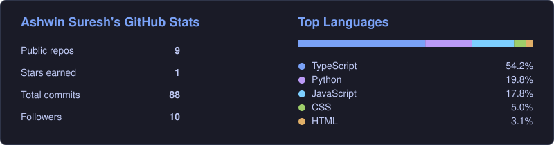

<h1 align="center">Hi 👋, I'm Ashwin</h1>

  <b>Software Systems Student | Technical Lead @ FOSS-CIT | Backend & Scalable Systems Enthusiast | Full Stack Development | Driven by Passion</b>

  <i>"Anchored in Fundamentals, Building systems for the Future"</i>

---

## 🚀 About Me

-  I'm curious and passionate about **Solving Realworld problems with a Enginnering perspective**
-  M.Sc. Software Systems at **Coimbatore Institute of Technology** (CGPA 8.66 / 10)
-  Previously a **Software Development Intern** at Lakshmi Life Sciences
-  Solved **520+ DSA problems** on LeetCode; winner and runner-up in multiple coding contests
-  I'm looking for **internship opportunities** and **open-source collaborations**
-  How to reach me: [ashwinsuresh.cit@gmail.com](mailto:ashwinsuresh.cit@gmail.com)

---

## 🛠️ Languages and Tools

  

---

## 📊 GitHub Stats

  

---

## 🔗 Connect with me

  
  
  
  

